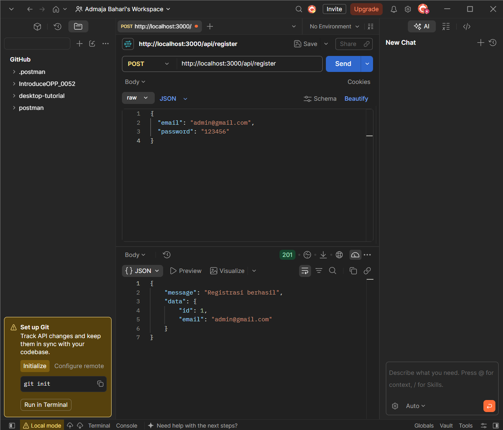
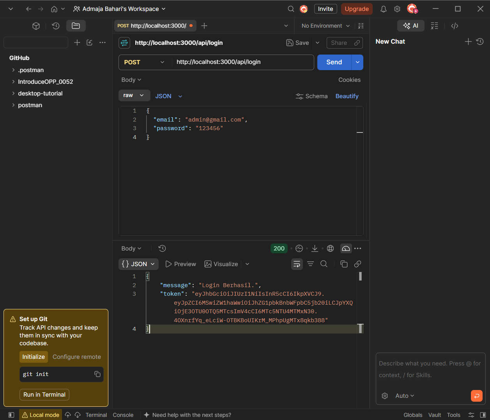
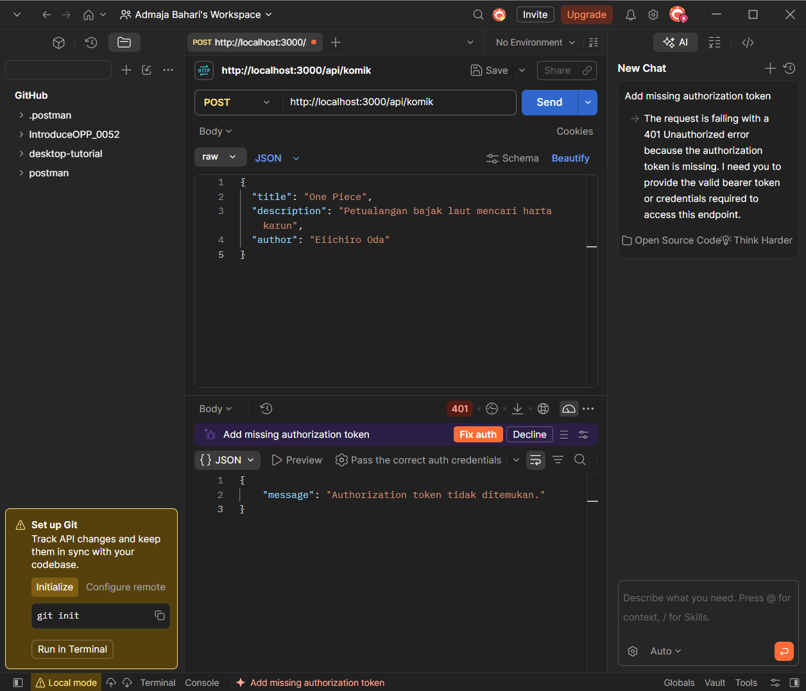
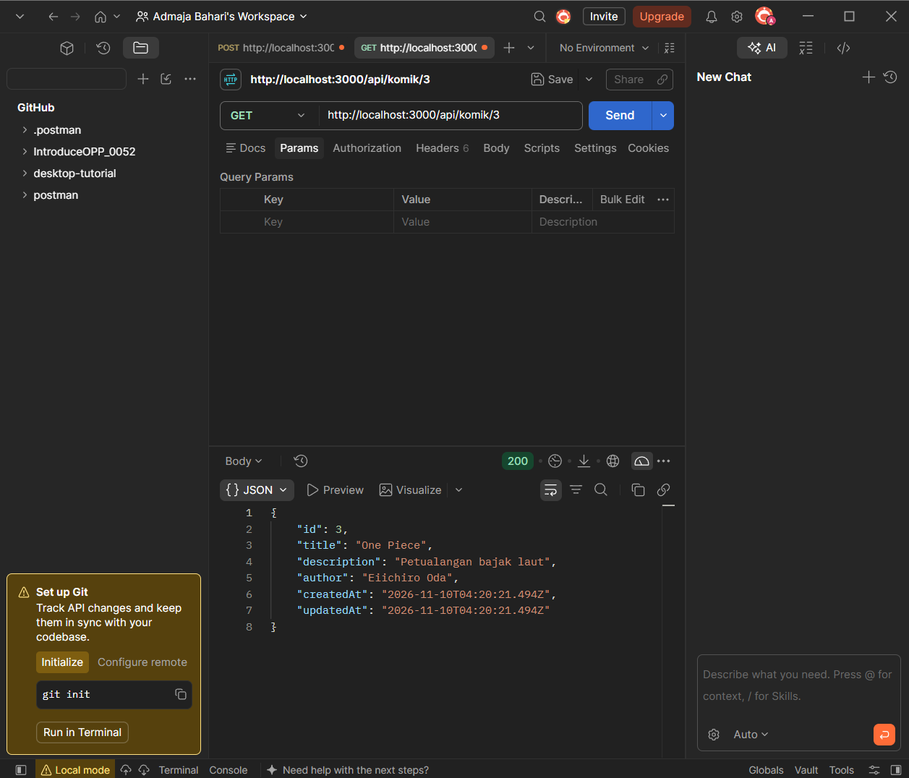
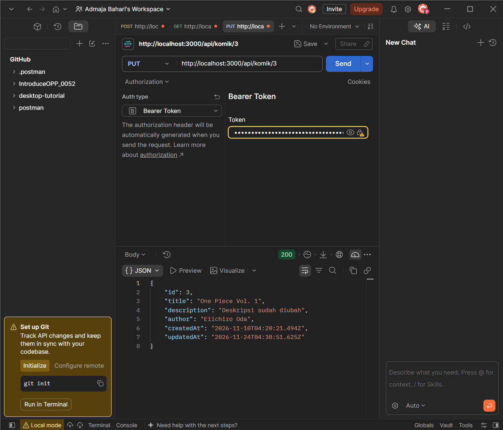
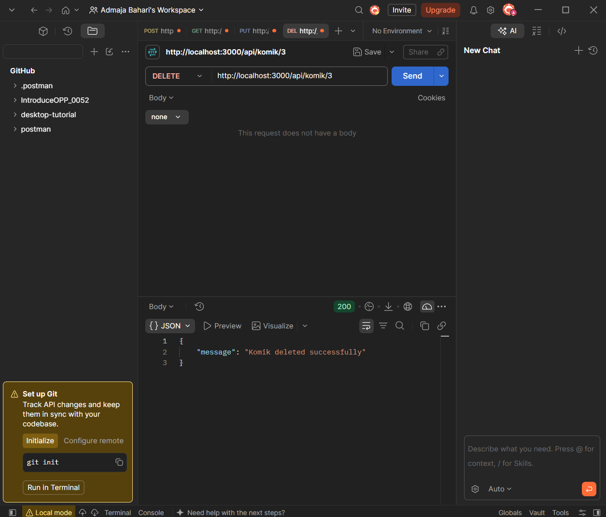

# API Perpustakaan Komik (JWT Authentication)

REST API sederhana untuk manajemen data komik dengan autentikasi **JSON Web Token (JWT)**. Dibuat sebagai tugas Pemrograman Web Service (PWS) Pertemuan 11.

## Teknologi

- Node.js + Express
- PostgreSQL
- Sequelize (ORM)
- JSON Web Token (`jsonwebtoken`)
- bcrypt (hash password)
- dotenv
- nodemon

## Struktur Folder

```
052_JWT/
├── config/          # konfigurasi koneksi database
├── controllers/     # logika endpoint (user & komik)
├── docs/images/     # screenshot hasil pengujian Postman
├── middleware/      # middleware verifikasi JWT
├── models/          # model Sequelize (User, Komik)
├── routes/          # definisi route API
├── .env             # variabel lingkungan (tidak di-commit)
├── .gitignore
├── .sequelizerc
├── index.js         # entry point server
└── package.json
```

## Instalasi

1. Clone repository

   ```bash
   git clone https://github.com/AdmajaBahari/052_JWT.git
   cd 052_JWT
   ```

2. Install dependency

   ```bash
   npm install
   ```

3. Buat database PostgreSQL bernama `perpustakaan`.

4. Buat file `.env` di root project:

   ```env
   DB_USER=postgres
   DB_PASSWORD=password_kamu
   DB_DATABASE=perpustakaan
   DB_HOST=localhost
   DB_PORT=5432
   DB_DIALECT=postgres

   PORT=3000

   JWT_SECRET=ganti_dengan_secret_yang_panjang_dan_acak
   JWT_EXPIRES=1d
   ```

   > `JWT_EXPIRES` harus berisi durasi yang valid seperti `1d`, `2h`, atau `3600`.

5. Jalankan server

   ```bash
   npm run dev
   ```

   Server berjalan di `http://localhost:3000`. Tabel dibuat otomatis lewat `sequelize.sync()`.

## Daftar Endpoint

Base URL: `http://localhost:3000/api`

### Autentikasi (tanpa token)

| Method | Endpoint    | Keterangan               |
|--------|-------------|--------------------------|
| POST   | `/register` | Registrasi akun baru     |
| POST   | `/login`    | Login dan mendapat token |

### Komik (wajib token)

| Method | Endpoint     | Keterangan                 |
|--------|--------------|----------------------------|
| GET    | `/komik`     | Ambil semua komik          |
| GET    | `/komik/:id` | Ambil komik berdasarkan id |
| POST   | `/komik`     | Tambah komik               |
| PUT    | `/komik/:id` | Ubah komik                 |
| DELETE | `/komik/:id` | Hapus komik                |

Semua endpoint komik membutuhkan header:

```
Authorization: Bearer <token>
```

## Hasil Pengujian (Postman)

### 1. Register

`POST /api/register`

```json
{
  "email": "admin@gmail.com",
  "password": "123456"
}
```

Hasil: `201 Created`, akun berhasil dibuat.



### 2. Login

`POST /api/login`

```json
{
  "email": "admin@gmail.com",
  "password": "123456"
}
```

Hasil: `200 OK`, server mengembalikan token JWT.



### 3. Akses tanpa token

`POST /api/komik` tanpa header Authorization.

Hasil: `401 Unauthorized` dengan pesan "Authorization token tidak ditemukan." Ini membuktikan endpoint komik terlindungi oleh middleware JWT.



### 4. Get komik berdasarkan id

`GET /api/komik/3` dengan Bearer Token.

Hasil: `200 OK`, data komik ditampilkan.



### 5. Update komik

`PUT /api/komik/3` dengan Bearer Token.

```json
{
  "title": "One Piece Vol. 1",
  "description": "Deskripsi sudah diubah",
  "author": "Eiichiro Oda"
}
```

Hasil: `200 OK`, data berubah dan `updatedAt` diperbarui.



### 6. Hapus komik

`DELETE /api/komik/3` dengan Bearer Token.

Hasil: `200 OK`, pesan "Komik deleted successfully".



## Kode Status

| Kode | Arti                                                         |
|------|--------------------------------------------------------------|
| 200  | Berhasil                                                     |
| 201  | Data berhasil dibuat                                         |
| 400  | Input tidak lengkap                                          |
| 401  | Token tidak ada, tidak valid, kedaluwarsa, atau login salah  |
| 404  | Data tidak ditemukan                                         |
| 409  | Email sudah terdaftar                                        |
| 500  | Kesalahan server                                             |

## Alur Autentikasi

1. User login dengan email dan password.
2. Server membandingkan password dengan hash di database (bcrypt).
3. Jika cocok, server membuat token JWT berisi `id` dan `email`, berlaku sesuai `JWT_EXPIRES`.
4. Client mengirim token lewat header `Authorization: Bearer <token>`.
5. `authMiddleware` memverifikasi token sebelum request diteruskan ke controller.

## Author

- Admaja Bahari
